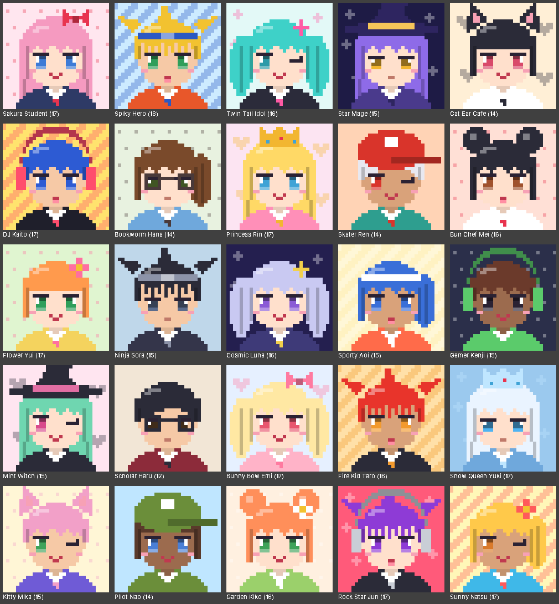
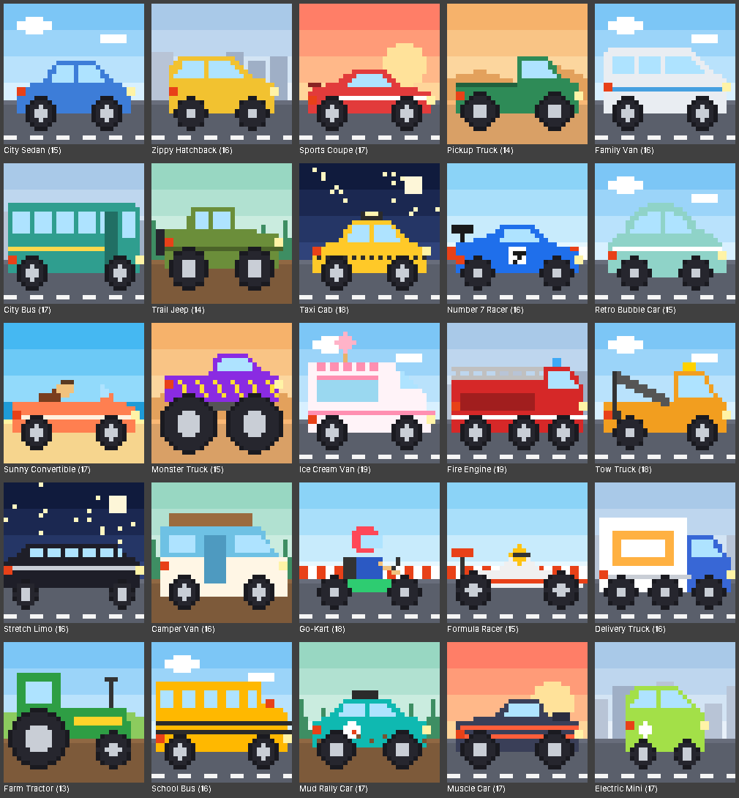
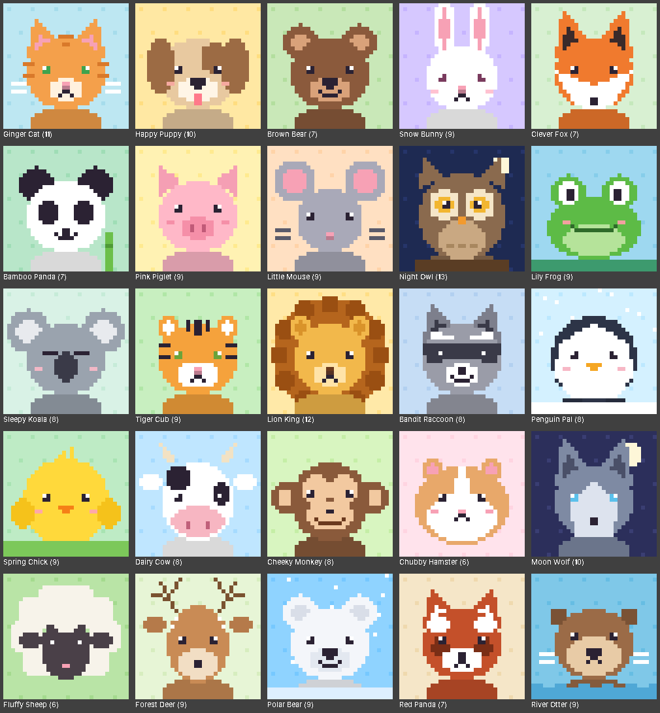
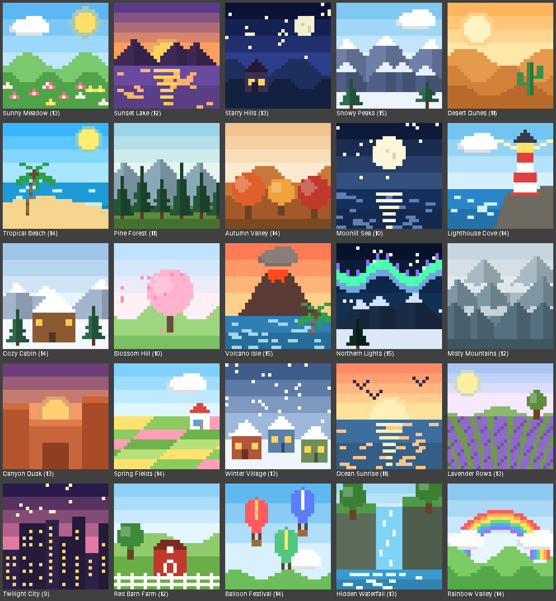

# Pixel Paint

A color-by-number pixel art game for Android, built with Kotlin and Jetpack Compose.

- **100 original artworks** in four categories: Anime, Cars, Animals and Scenes.
- **Import any photo** and turn it into a numbered pixel art puzzle (16–64 cells wide, 4–32 colors).
- **Editor-style tools**: pencil, brush, bucket fill, eraser, color picker, hand, plus undo and redo.
- **Pinch to zoom**, auto-saved progress, and **reset** for any artwork.

See [docs/ARCHITECTURE.md](docs/ARCHITECTURE.md) for the system architecture, file structure
and UI architecture.

| Anime | Cars |
|---|---|
|  |  |
| **Animals** | **Scenes** |
|  |  |

## Build

Requirements: JDK 17 and the Android SDK (API 36). Open the project in Android Studio, or:

```sh
./gradlew :core:test          # game rules, catalog, converter and storage tests
./gradlew :app:assembleDebug  # app/build/outputs/apk/debug/app-debug.apk
```

Every pull request runs both in GitHub Actions and attaches the debug APK to the run.

## Modules

| Module | Contents |
|---|---|
| `:core` | Pure Kotlin: art model, the 100 procedural artworks, photo converter, tool rules, undo, storage |
| `:app` | Android: Compose UI, ViewModels, navigation, photo decoding |
