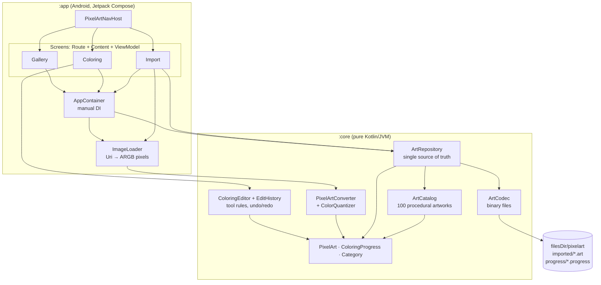

# Pixel Paint: architecture

Pixel Paint is a color-by-number pixel art game for Android. Players pick one of 100 bundled
artworks (Anime, Cars, Animals, Scenes), paint numbered cells with the matching palette color,
and can turn their own photos into new puzzles. Progress saves automatically and any artwork can
be reset.

This document covers the system architecture, the file structure, and the UI architecture.

## 1. Goals and constraints

| Goal | Decision |
|---|---|
| Works offline, instant start | No network, no image assets: the 100 artworks are generated in code and cached in memory on first use. |
| Saved progress never breaks across updates | Artworks are deterministic (same id → same cells). Stored progress is validated against the artwork when loaded and out-of-range values are dropped. |
| Game rules are testable without a device | All rules live in a pure Kotlin/JVM `:core` module with unit tests. Android code only renders and forwards input. |
| Smooth on big grids (64×64 imports) | The canvas draws only visible cells, reads zoom and pan in the draw phase, and caches measured number labels. Gallery thumbnails are 1 px per cell bitmaps, not thousands of rects. |
| Minimal but production shaped | MVVM with unidirectional data flow, a single repository, manual DI, atomic file writes, R8 for release, CI that runs tests and builds the APK. |

## 2. System architecture



### Layers

**`:core`, the domain and data layer (no Android dependencies).**

- `model`: `PixelArt` (immutable grid of palette indices plus palette), `ColoringProgress`
  (immutable painted state, every edit returns a new instance), `Category`, `ArtSummary`.
- `catalog`: `ArtCatalog` plus one file per category. Each artwork is drawn on a tiny software
  canvas (`raster/Raster`) with ellipses, polygons and lines, then converted to a palette sorted
  dark to light. All art is original: no existing characters, logos or brands.
- `convert`: `PixelArtConverter` turns decoded pixels into a `PixelArt` with an area-average
  downscale, transparency composited over white, median-cut and k-means palette quantization,
  and perceptual ("redmean") nearest-color matching.
- `editor`: `ColoringEditor` decides which cells each tool changes; `EditHistory` keeps bounded
  undo/redo stacks of per-stroke diffs.
- `data`: `ArtRepository` loads built-in and imported art plus all progress once, exposes
  `summaries: Flow<List<ArtSummary>>`, and persists through `ArtCodec` with temp-file-and-rename
  atomic writes. Disk work runs on an injected dispatcher, so tests use a test dispatcher.

**`:app`, the presentation layer.**

- One `ViewModel` per screen exposes a single `StateFlow<UiState>` and plain intent functions.
- `AppContainer` (owned by `PixelArtApplication`) creates the repository and image loader;
  ViewModel factories pull from it through `CreationExtras`.
- `ImageLoader` decodes a picked `Uri` with `ImageDecoder` (API 28+, applies EXIF rotation) or
  `BitmapFactory` with `inSampleSize`, capped at 512 px, so large photos never need full-size
  memory.

### Data flow (unidirectional)

```
touch → PixelGrid → ColoringViewModel.onStrokeMove(cell)
      → ColoringEditor.changesFor(tool, cell, color, brush, progress)
      → new ColoringProgress → StateFlow<ColoringUiState> → recomposition / redraw
finger up → onStrokeEnd → EditHistory.record(diff) → ArtRepository.saveProgress
          → in-memory library updated → Gallery's summaries Flow emits → thumbnail refreshes
```

### Game rules

| Tool | Behavior |
|---|---|
| Pencil | Paints the touched cell with the selected color. Wrong colors are allowed and shown tinted with a red number. |
| Brush | Paints a 1–5 cell square, only where the cell's number matches the selected color. |
| Bucket | Fills every 4-connected cell sharing the tapped cell's number. |
| Eraser | Clears painted cells in a 1–5 cell square. |
| Color Picker | Selects the tapped cell's number, then returns to the previous tool. |
| Hand | One-finger pan. Two fingers always zoom and pan, whatever the tool. |

Painting tools never overwrite a correctly painted cell, so a stray stroke cannot undo finished
work. A stroke is one undo step. When a color is finished the palette jumps to the next unfinished
one, and finishing every cell shows the completion dialog. **Reset** (top bar, with confirmation)
clears the artwork's progress, deletes its progress file and clears undo history.

### Persistence format

| File | Content |
|---|---|
| `imported/<id>.art` | `PXA1` magic, id, title, category, width, height, palette (ARGB ints), one byte per cell |
| `progress/<id>.progress` | `PXP1` magic, art id, cell count, one byte per cell (painted index + 1, 0 = unpainted) |

Palettes are capped at 48 colors, so a byte per cell is enough. A 64×64 import is about 4 KB. The
files are included in Android Auto Backup.

## 3. File structure

```
.
├── build.gradle.kts, settings.gradle.kts, gradle.properties
├── gradle/libs.versions.toml            Version catalog (AGP, Kotlin, Compose BOM, …)
├── .github/workflows/android.yml        CI: core unit tests + debug APK artifact
├── docs/
│   ├── ARCHITECTURE.md                  This document
│   └── images/catalog-*.png             Contact sheets of the 100 artworks
├── core/                                Pure Kotlin/JVM module
│   └── src/main/kotlin/com/avgogames/pixelart/core/
│       ├── model/        PixelArt, ColoringProgress, Category, ArtSummary
│       ├── raster/       Raster (software canvas), Colors (rgb, mix, shade, luminance)
│       ├── catalog/      ArtCatalog, AnimeArt, CarArt, AnimalArt, SceneArt
│       ├── convert/      PixelArtConverter, ColorQuantizer
│       ├── editor/       Tool, ColoringEditor, EditHistory
│       └── data/         ArtRepository, ArtCodec
│   └── src/test/kotlin/…                Catalog, codec, repository, progress, editor, converter tests
└── app/                                 Android application module
    └── src/main/
        ├── AndroidManifest.xml
        ├── res/          strings, theme, adaptive launcher icon, backup rules
        └── java/com/avgogames/pixelart/
            ├── PixelArtApplication.kt   Owns AppContainer
            ├── MainActivity.kt          Edge-to-edge host for Compose
            ├── di/AppContainer.kt       Manual DI
            ├── data/ImageLoader.kt      Uri → DecodedImage
            └── ui/
                ├── ViewModelSupport.kt  CreationExtras.appContainer()
                ├── navigation/          PixelArtNavHost, Routes
                ├── theme/               PixelPaintTheme, PixelColors
                ├── components/          PixelArtImage, SquareIconButton, PixelIcons
                ├── gallery/             GalleryViewModel, GalleryScreen
                ├── coloring/            ColoringViewModel, ColoringScreen, ColoringControls, PixelGrid
                └── importer/            ImportViewModel, ImportScreen
```

## 4. UI architecture

### Navigation

```
gallery ──tap card──▶ coloring/{artId}
   │
   └──Import photo──▶ import ──Create artwork──▶ coloring/{newId}   (import popped off the stack)
```

`Routes` owns the route strings. The coloring screen reads `artId` from its `SavedStateHandle`.

### Screen pattern

Every screen is split into three parts, following the state-hoisting guidance in
`.claude/skills/compose-state-and-effects`:

1. **`XxxRoute`**: wiring only. Gets the ViewModel, collects state with
   `collectAsStateWithLifecycle`, owns platform launchers (photo picker) and one-shot events
   (import → navigate, delivered through a buffered `Channel`).
2. **`XxxContent`**: a plain composable taking immutable UI state and callbacks. It can be
   previewed and tested with sample state and no app graph. Runtime UI objects (the canvas
   `GridViewport`, the tool-panel open flag) are created here with remembered defaults.
3. **`XxxViewModel`**: produces one `StateFlow<XxxUiState>` and exposes intent functions.

| Screen | UI state | Owned in composition |
|---|---|---|
| Gallery | category (saved in `SavedStateHandle`), filtered summaries, finished count | pending delete dialog |
| Coloring | art, progress, selected color, tool, brush size, undo/redo availability, completion | `GridViewport` (zoom and pan), tool panel, reset dialog |
| Import | has image, preview art, grid width, color count, title, working and saving flags | none |

### Coloring screen layout

The layout follows the editor reference screen the user shared:

```
┌────────────────────────────────────────┐
│ [←]  Title             [⤢ fit] [⟲ reset] │  white square icon buttons
│      42% · 430/1024                    │
├────────────────────────────────────────┤
│ ┌TOOLS──────────┐                      │
│ │▌✎ Pencil     ▐│   PixelGrid          │  tool drawer slides in from the left
│ │ 🖌 Brush       │   (zoom / pan /      │
│ │ 🪣 Bucket      │    paint canvas)     │
│ │ ⌫ Eraser      │                      │
│ │ 💧 Color Picker│                      │
│ │ ✋ Hand        │                      │
│ │   × CLOSE     │                      │
│ └───────────────┘                      │
├────────────────────────────────────────┤
│ [tool] (●7) [──●── size 3]  [↶] [↷]    │  bottom bar
│ [1][2][3][4][5][✓][7][8]…              │  numbered palette strip
└────────────────────────────────────────┘
```

### Canvas rendering (`PixelGrid`)

- Unpainted cells are grey "paper" whose tone follows the target color's lightness, so the
  picture is readable before painting. Cells of the selected number are tinted blue.
- Numbers appear once cells are at least 14 dp, grid lines at 7 dp, and both disappear when the
  artwork is complete.
- Only cells inside the viewport are drawn. Zoom and pan live in `GridViewport` snapshot state
  that is read inside the `Canvas` draw lambda and the pointer handler, so pinch zoom redraws
  without recomposing the screen.
- Gestures: one pointer within touch slop is a tap; one pointer past slop paints (pencil,
  brush, eraser) or pans (other tools); a second pointer switches the gesture to zoom and pan and
  ends any stroke. Fast drags are joined with Bresenham lines so strokes have no gaps.

### Theme

Material 3 with a custom light scheme: paper-white surfaces (`#F3F4F7`), one blue accent
(`#2F9BF0`, the reference's selected-tool blue), white rounded-square tool buttons with a soft
shadow. All user-facing text is in `res/values/strings.xml`.

## 5. Testing and CI

- `./gradlew :core:test` runs 30 JVM tests covering the catalog (exactly 100, 25 per category,
  unique and playable), progress math, tool rules and undo, converter behavior (aspect ratio,
  color limit, transparency, exact flat colors), codec round trips, and repository persistence,
  reset and import or delete.
- `.github/workflows/android.yml` runs those tests and `:app:assembleDebug` on every pull request
  and uploads the debug APK as a build artifact.

## 6. Next steps beyond the minimal version

- Compose UI tests for the three `Content` composables and screenshot tests of `PixelGrid`.
- Room or DataStore if the library grows past a few hundred imports, or if cloud sync is added.
- Hilt once the dependency graph grows beyond two objects.
- Daily artwork, hints (flash the next unpainted cell) and sharing a finished artwork as an image.
