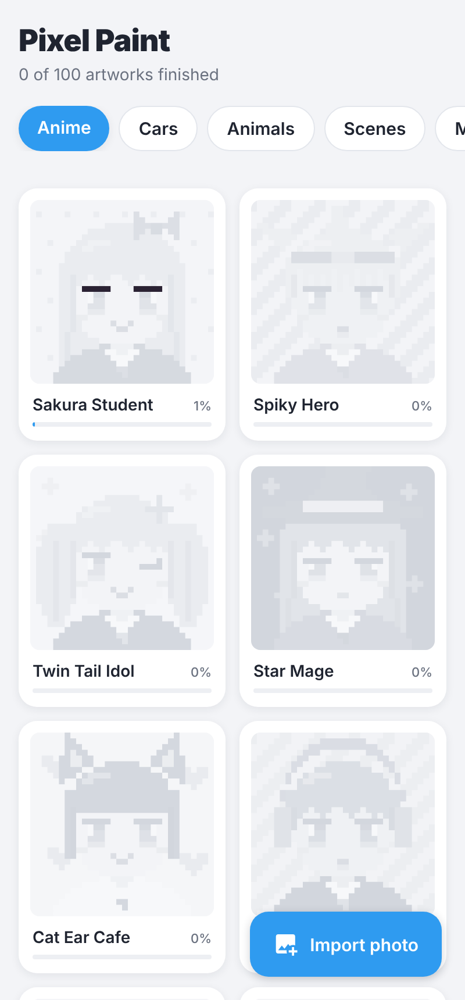
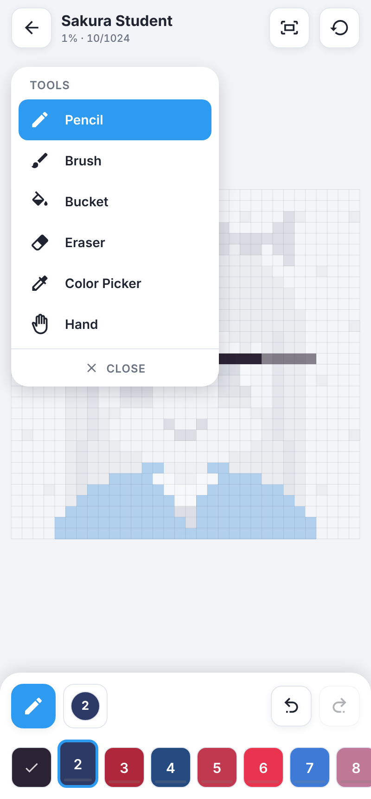
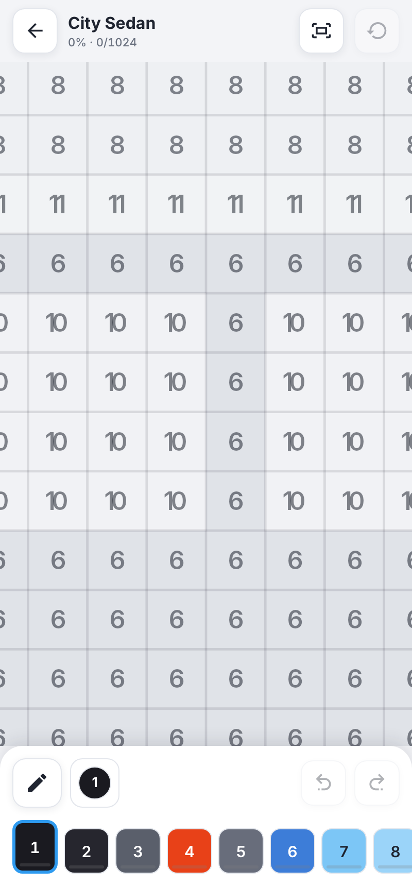
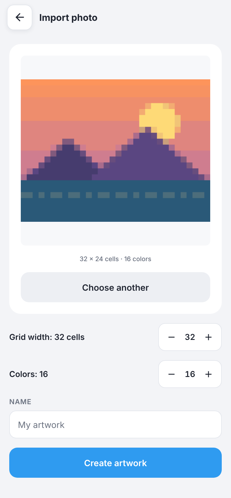

# Pixel Paint (React Native)

The React Native version of [Pixel Paint](../README.md), built with Expo, TypeScript and
React Native Skia. It has the same game as the Kotlin app in this repo:

- **The same 100 original artworks** (Anime, Cars, Animals, Scenes), exported from the Kotlin
  catalog, so ids and pixels match exactly.
- **Import any photo** and turn it into a numbered puzzle (16–64 cells wide, 2–32 colors).
- **Editor-style tools**: pencil, brush, bucket fill, eraser, color picker and hand, plus undo/redo.
- **Pinch to zoom**, auto-saved progress, and **reset** for any artwork.

| Gallery | Coloring | Zoomed in | Photo import |
|---|---|---|---|
|  |  |  |  |

_Screenshots from the web preview (`npm run web`)._

See [docs/ARCHITECTURE.md](docs/ARCHITECTURE.md) for the architecture, file structure and UI
architecture.

## Run it

Requirements: Node 22.

```sh
cd pixel-paint-rn
npm install
npm start            # scan the QR code with Expo Go (Android or iOS)
npm run web          # browser preview at http://localhost:8081
```

Every dependency is part of Expo Go, so no native build is needed while developing.

## Get an APK (phones, tablets, Fire tablets)

- **From CI:** every pull request that touches this folder builds a release APK. Download
  `pixel-paint-rn-apk` from the run's artifacts and sideload it.
- **With EAS (cloud):** `npx eas-cli@latest build -p android --profile preview`.
- **Locally (Android SDK installed):** `npx expo run:android --variant release`.

## Checks

```sh
npm run typecheck    # TypeScript
npm test             # 30 Jest tests: catalog, progress, tools, undo, converter, storage
npm run export:android
```

## Updating the artworks

The artworks are drawn in Kotlin (`core/catalog`). After changing them, regenerate the JSON from
the repo root; CI fails if the two drift apart:

```sh
./gradlew -p pixel-paint-rn/scripts/export-catalog :exporter:run
```
