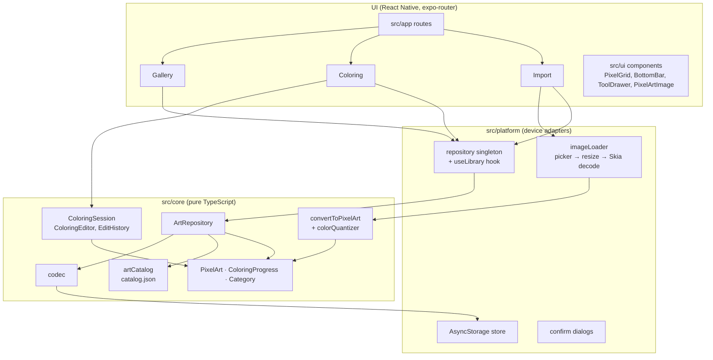

# Pixel Paint (React Native): architecture

This app is a port of the Kotlin/Compose app in the repo root (see
[../../docs/ARCHITECTURE.md](../../docs/ARCHITECTURE.md)). It keeps the same layering, rules
and screen layout, so the two can be read side by side.

## 1. Goals and constraints

| Goal | Decision |
|---|---|
| Identical game on both stacks | The 100 artworks are **exported** from the Kotlin catalog as JSON (`scripts/export-catalog`) instead of re-drawn in TypeScript, so ids and pixels match exactly. CI regenerates the file and fails on drift. |
| Rules testable without a device | All rules live in `src/core`: plain TypeScript with no React or React Native imports, covered by Jest. |
| Smooth on big grids (64×64 imports) | The canvas is React Native Skia. Cells, grid and numbers are recorded as `SkPicture`s once per change, and pinch/pan only changes one transform. Same-color runs are merged into single rects. |
| Cheap gallery | Thumbnails are pre-scaled PNGs rendered once per progress snapshot (cached in a `WeakMap`) and shown with `<Image>`, not one GPU canvas per card. |
| Runs in Expo Go | Only Expo SDK 58 bundled modules: Skia, AsyncStorage, image picker, image manipulator, expo-router. |
| Saved progress never breaks | Progress is stored with its cell count and restored defensively; out-of-range values are dropped and corrupt entries are skipped, never fatal. |

## 2. System architecture



### Kotlin to TypeScript map

| Kotlin (`core`, `app`) | React Native (`src`) |
|---|---|
| `model/PixelArt`, `ColoringProgress`, `Category` | `core/model/*` (same API: `with`, `restore`, `correctCountPerColor`) |
| `catalog/ArtCatalog` + 4 drawing files | `core/catalog/catalog.json` + `artCatalog.ts` |
| `convert/PixelArtConverter`, `ColorQuantizer` | `core/convert/*` (same downscale, median cut, k-means, redmean distance) |
| `editor/ColoringEditor`, `EditHistory`, `Tool` | `core/editor/*` |
| `ColoringViewModel` | `core/editor/coloringSession.ts` (framework-free, unit-tested) |
| `data/ArtRepository` + `ArtCodec` (binary files) | `core/data/artRepository.ts` + `codec.ts` (AsyncStorage strings) |
| `ImageLoader` (`ImageDecoder`) | `platform/imageLoader.ts` |
| `AppContainer` (manual DI) | `platform/repository.ts` (one module-level instance) |

### Data flow (unidirectional)

```
touch → PixelGrid (PanResponder) → ColoringSession.strokeMove(cell)
      → ColoringEditor.changesFor(tool, cell, color, brush, progress)
      → new ColoringProgress → listeners → useSyncExternalStore → re-render
finger up → strokeEnd → EditHistory.record(diff) → onCommit → ArtRepository.saveProgress
          → library snapshot replaced → Gallery (useLibrary) re-renders → thumbnail re-rendered
```

### Game rules

Identical to the Kotlin app: pencil paints one cell (mistakes allowed, shown tinted with a red
number); brush paints a 1–5 square only where the number matches; bucket fills the 4-connected
region; eraser clears a 1–5 square; color picker selects the tapped number then returns to the
previous tool; hand pans. Correct cells are never overwritten by painting tools. A stroke is one
undo step. Finishing a color jumps to the next unfinished one; finishing the artwork shows the
completion dialog. **Reset** (top bar, with confirmation) clears progress, its stored entry and
the undo history.

### Persistence format (AsyncStorage)

| Key | Value |
|---|---|
| `pixelpaint:v1:art:<id>` | `{ createdAt, art }` where `art` is JSON: id, title, category, size, `#rrggbb` palette, one character per cell |
| `pixelpaint:v1:progress:<id>` | `<cell count>:<one character per cell>` (`.` = unpainted) |

A 64×64 import or its progress is about 4 KB, the same as the Android app's binary files.

## 3. File structure

```
pixel-paint-rn/
├── app.json, eas.json, package.json, tsconfig.json
├── index.ts, index.web.ts      Entry points (web loads CanvasKit before the app)
├── assets/                      App icon, adaptive icon layers, splash (same pixel heart as Android)
├── docs/ARCHITECTURE.md         This document
├── scripts/export-catalog/      Standalone Gradle build: Kotlin catalog → catalog.json
└── src/
    ├── app/                     expo-router routes (screens only)
    │   ├── _layout.tsx          Stack navigator
    │   ├── index.tsx            Gallery
    │   ├── color/[id].tsx       Coloring screen
    │   └── import.tsx           Photo import
    ├── core/                    Pure TypeScript, no React
    │   ├── model/               PixelArt, ColoringProgress, Category, ArtSummary
    │   ├── editor/              Tool, ColoringEditor, EditHistory, ColoringSession
    │   ├── convert/             pixelArtConverter, colorQuantizer
    │   ├── catalog/             catalog.json (100 artworks), artCatalog
    │   ├── data/                ArtRepository, codec, KeyValueStore (+ MemoryStore for tests)
    │   ├── color.ts             RGB helpers (mix, luminance, hex)
    │   └── __tests__/           30 Jest tests
    ├── platform/                AsyncStorage adapter, repository instance, image loader, confirm dialogs
    └── ui/
        ├── theme.ts             Colors, type scale, cell tones
        ├── components/          PixelArtImage, SquareIconButton, Stepper
        ├── gallery/             ArtCard, CategoryTabs
        └── coloring/            PixelGrid, gridPictures, gridViewport, BottomBar, ToolDrawer,
                                 CompletionDialog, useColoringSession
```

## 4. UI architecture

### Navigation (expo-router)

```
/ (gallery) ──tap card──▶ /color/[id]
   │
   └──Import photo──▶ /import ──Create artwork──▶ /color/[newId]   (router.replace)
```

### Screen pattern

- **Route files** in `src/app` only wire state to components: they read params, call hooks and
  pass plain props and callbacks.
- **State** lives outside React where it has rules: `ArtRepository` (library) and
  `ColoringSession` (one artwork). Both expose `subscribe` + `getSnapshot` and are read with
  `useSyncExternalStore`, so every render sees one consistent, immutable snapshot.
- **View-only state** (zoom and pan, tool drawer open, fit key) stays in components with
  `useState`, like the Compose version keeps `GridViewport` in composition.

| Screen | Source of truth | Local UI state |
|---|---|---|
| Gallery | `useLibrary()` | selected category |
| Coloring | `useColoringSession(id)` | viewport, tool drawer, fit key |
| Import | decoded image + settings (`useState`); preview via `useMemo` | picking, saving, error |

### Coloring screen layout

Same as the Android app, from the editor reference the user shared:

```
┌────────────────────────────────────────┐
│ [←]  Title             [⤢ fit] [⟲ reset] │  white square icon buttons
│      42% · 430/1024                    │
├────────────────────────────────────────┤
│ ┌TOOLS──────────┐                      │
│ │▌✎ Pencil     ▐│   PixelGrid          │  tool drawer over the canvas
│ │ 🖌 Brush       │   (zoom / pan /      │
│ │ 🪣 Bucket      │    paint canvas)     │
│ │ ⌫ Eraser      │                      │
│ │ 💧 Color Picker│                      │
│ │ ✋ Hand        │                      │
│ │   × CLOSE     │                      │
│ └───────────────┘                      │
├────────────────────────────────────────┤
│ [tool] (●7) [− 3 +]          [↶] [↷]   │  bottom sheet
│ [1][2][3][4][5][✓][7][8]…              │  numbered palette strip
└────────────────────────────────────────┘
```

### Canvas (`PixelGrid`)

- Pictures are recorded in "art space" (16 units per cell) and drawn under one
  `translate + scale` transform, so zooming never re-records them.
- Unpainted cells are grey paper whose tone follows the target color's lightness; cells of the
  selected number are tinted blue; wrong cells are washed with the wrong color and get a red
  number.
- Grid lines show from 7 dp cells and numbers from 14 dp, both hidden once complete. Numbers use
  a bundled Inter SemiBold so they look the same on every platform.
- Gestures (`PanResponder`): one finger within 8 dp slop is a tap; past the slop it paints
  (pencil, brush, eraser) or pans (other tools); a second finger switches to pinch-zoom and pan
  and ends any stroke. Fast drags are joined with Bresenham lines, and zoom keeps the point under
  the fingers fixed.

## 5. Testing and CI

- `npm test` runs 30 Jest tests: catalog (100 artworks, 25 per category, unique, playable,
  distinct), progress math, every tool rule, undo/redo, the session (strokes, auto-advance,
  completion, picker, reset), converter (aspect ratio, color limit, transparency, exact flat
  colors, no upscaling) and repository persistence, reset, import, delete and corrupt data.
- `.github/workflows/react-native.yml` runs typecheck, tests, the catalog drift check and an
  Android bundle, then builds a release APK and uploads it as an artifact.

## 6. Next steps

- Component tests with React Native Testing Library for the three screens.
- Haptic feedback when a color is finished, and a share button for finished artworks.
- Mouse-wheel zoom in the web preview.
